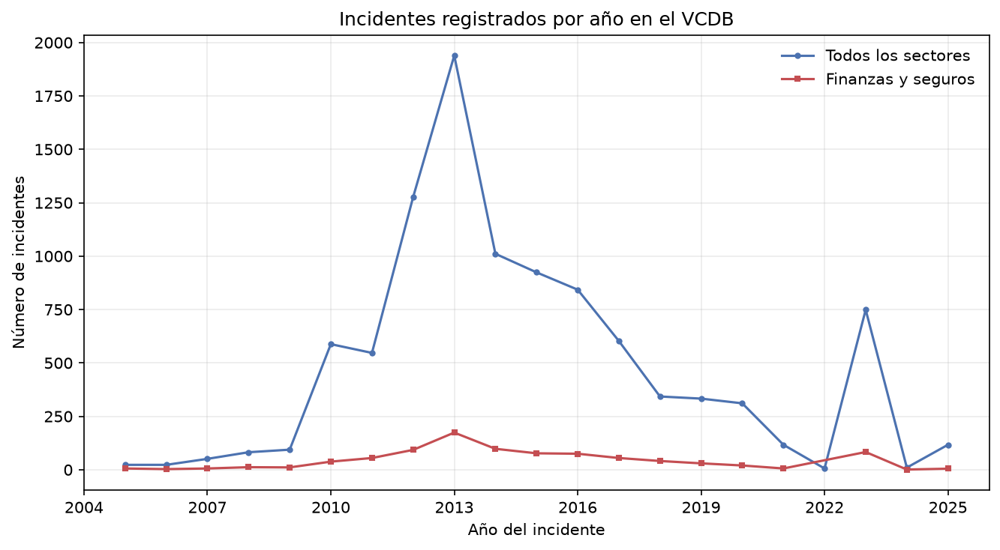
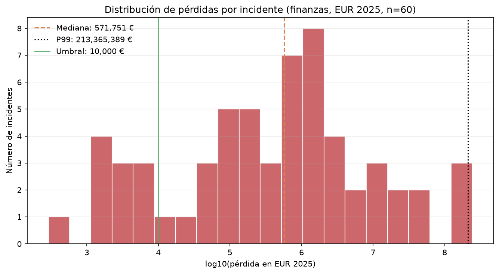
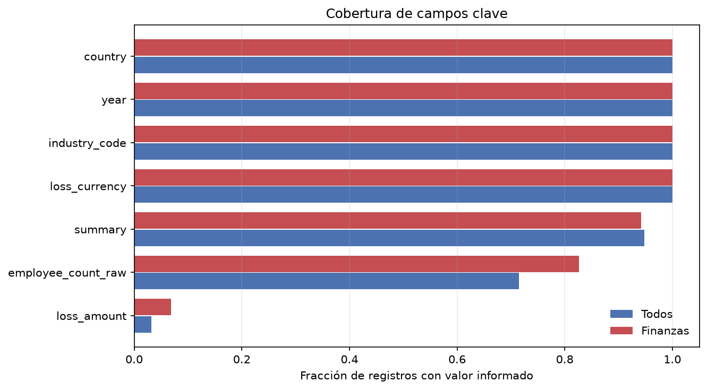
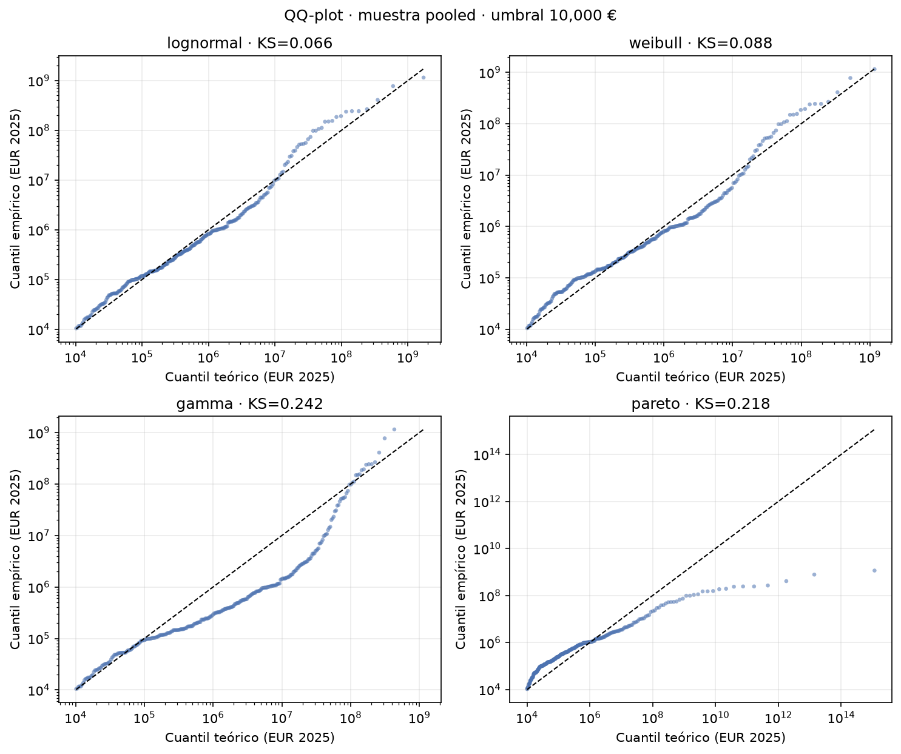
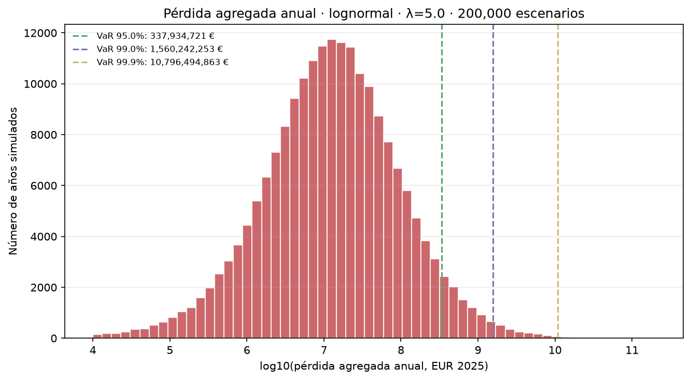
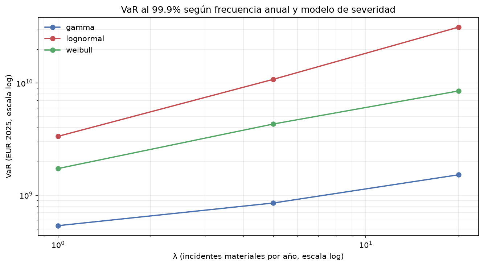
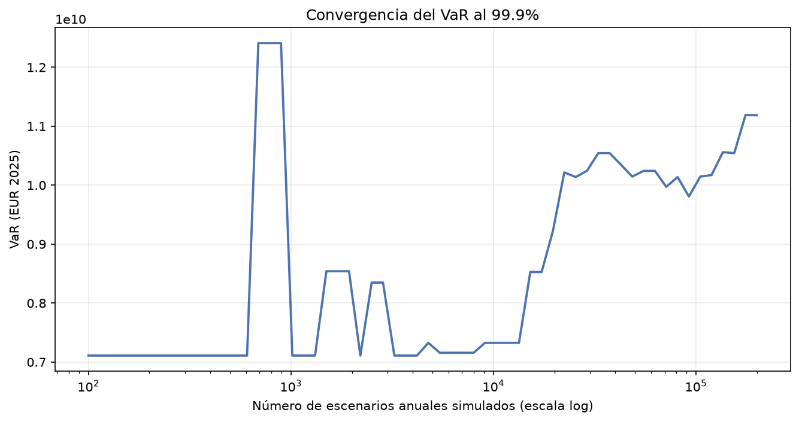

# Cyber-VaR DORA

[](https://github.com/Dani27el093/cyber-var-dora/actions/workflows/ci.yml)

Cuantificación del **Valor en Riesgo (VaR)** por incidentes de ciberseguridad en entidades financieras, usando un enfoque de **distribución de pérdidas (LDA)**: frecuencia de Poisson + severidad de cola pesada + simulación de Montecarlo.

El objetivo es construir una herramienta reproducible que traduzca el histórico de incidentes en una distribución anual de pérdidas y permita responder preguntas de negocio como:

- ¿Cuánto capital económico debería reservar una entidad para cubrir un año adverso?
- ¿Cómo cambia esa cifra si la frecuencia de ataques se duplica?
- ¿Qué parte del riesgo explican los eventos de baja frecuencia y alta severidad?

> **Contexto regulatorio.** DORA (Reglamento (UE) 2022/2554) exige un marco de gestión del riesgo TIC y capacidades de cuantificación, pero no impone una fórmula de VaR ni un capital regulatorio único. En este proyecto el VaR se interpreta como **capital económico interno**, herramienta de apetito de riesgo y stress testing, no como una cifra regulatoria prescrita.

---

## Estado del proyecto

| Fase | Descripción | Estado |
|---|---|---|
| 0 | Entorno, estructura y control de versiones | ✅ |
| 1 | Ingesta del VCDB | ✅ |
| 2 | Limpieza, filtrado y EDA | ✅ |
| 3 | Ajuste de frecuencia y severidad | ✅ |
| 4 | Montecarlo y VaR / Expected Shortfall | ✅ |
| 5 | Documentación y business case | ✅ |

Leyenda: ✅ completado · 🚧 en curso · ⏳ pendiente

**Documentación:** [Metodología](docs/metodologia.md) · [Business case DORA](docs/business_case.md) · [Decisiones](docs/decisiones.md) · [Diccionario de datos](docs/diccionario_datos.md)

---

## Fuente de datos

[VCDB (VERIS Community Database)](https://github.com/vz-risk/VCDB): base de incidentes de ciberseguridad de código abierto, codificados con el esquema VERIS.

El pipeline descarga el archivo combinado `data/joined/vcdb.json.zip`, que **excluye unas 5.000 brechas repetitivas de web skimmers** para no sesgar la muestra. El dataset bruto no se versiona en Git: se descarga con un script y se verifica con SHA-256.

### Perfil del dataset (EDA preliminar)

Tras el ETL (`scripts/build_dataset.py`) y el EDA (`scripts/run_eda.py`):

| Métrica | Todos los sectores | Finanzas y seguros (NAICS 52*) |
|---|---|---|
| Incidentes | 10.047 | 893 |
| Con importe extraíble | 325 | 61 (6,8%) |
| Con pérdida en EUR 2025 | 322 | 60 |
| En la ventana 2005-2025 | 9.990 | 889 |
| Mediana de pérdida (EUR 2025) | 243.861 € | 571.751 € |
| P99 (EUR 2025) | 261,2 M € | 213,4 M € |
| Máximo (EUR 2025) | 1.149 M € | 242,8 M € |

- Monedas en finanzas: **35 USD explícitos**, 19 sin moneda (asumidos USD, con flag), 2 THB, 2 GBP, 1 INR, 1 EUR y 1 ZAR.
- Normalización a **EUR 2025** con tipos medios anuales del BCE e HICP de la eurozona (Eurostat).
- La cobertura temporal está concentrada entre 2012 y 2018; el pico de 2023 y el valle de 2022 reflejan cambios de cobertura, no de frecuencia real.
- El máximo de 1·10¹² USD corresponde a un registro de Yahoo (2016) y es incompatible con las cifras públicas: se marca como **error de codificación** (`loss_suspect`) y se excluye del ajuste.
- Umbral de recolección: **10.000 €**; en finanzas quedan 49 pérdidas por encima del umbral.







**Implicación:** con n=60 no es posible estimar de forma robusta una severidad ni un VaR al 99,9%. El proyecto documenta esta limitación y contrasta la muestra *pooled* (n=283) con la de finanzas (n=49). Ver [`docs/decisiones.md`](docs/decisiones.md).

---

## Estructura

```text
.
├── config/
│   └── config.yaml          # Parámetros del pipeline y de la simulación
├── data/
│   ├── raw/                 # Descargas originales (ignoradas por Git)
│   ├── processed/           # Datasets limpios en Parquet (ignorados por Git)
│   └── reference/           # Tipos de cambio, inflación, umbrales
├── docs/
│   ├── business_case.md     # Encuadre DORA y recomendaciones
│   ├── decisiones.md        # Registro de decisiones metodológicas
│   ├── diccionario_datos.md # Esquema del dataset procesado
│   └── metodologia.md       # Documento metodológico completo
├── notebooks/               # EDA, ajuste y simulación (narrativa)
├── outputs/
│   ├── figures/             # Gráficos generados
│   ├── tables/              # Resultados en CSV
│   └── logs/
├── scripts/                 # Puntos de entrada ejecutables
├── src/cybervar/
│   ├── config.py            # Carga tipada de configuración
│   ├── data/                # Descarga y ETL
│   ├── models/              # Frecuencia y severidad
│   ├── simulation/          # Motor de Montecarlo
│   └── reporting/           # Gráficos y tablas
└── tests/                   # Tests con pytest
```

---

## Instalación

Requisitos: Python 3.12+ y Git.

```powershell
# 1. Crear y activar el entorno virtual
python -m venv .venv
.\.venv\Scripts\Activate.ps1

# 2. Instalar el paquete en modo editable (incluye dependencias de desarrollo)
python -m pip install --upgrade pip
python -m pip install -e ".[dev]"
```

---

## Uso

```powershell
# Descargar y verificar el VCDB (≈21 MB de JSON)
python scripts/download_data.py

# Construir tipos de cambio e inflación (BCE + Eurostat)
python scripts/build_reference_data.py

# Construir los datasets procesados (todos los sectores y solo finanzas)
python scripts/build_dataset.py

# Perfilado rápido y figuras del EDA
python scripts/run_eda.py

# Ajuste de severidad y comparación de modelos
python scripts/fit_severity.py

# Montecarlo, VaR, Expected Shortfall y sensibilidad
python scripts/run_simulation.py

# Todo lo anterior de una vez
python scripts/run_all.py
```

Los artefactos se generan en:

- `data/processed/incidents_all.parquet`
- `data/processed/incidents_finance.parquet`
- `outputs/tables/eda_summary.csv`
- `outputs/tables/severity_comparison_*.csv`
- `outputs/tables/var_results.csv`
- `outputs/figures/`

---

## Metodología (resumen)

1. **Frecuencia:** λ **no** se estima del VCDB, porque no es un censo y los conteos reflejan cobertura mediática. Se usan escenarios de **1, 5 y 20 incidentes materiales al año**; el conteo anual del VCDB se reporta solo como diagnóstico.
2. **Severidad:** máxima verosimilitud con **truncamiento por umbral** (10.000 €) de Lognormal, Weibull, Gamma y Pareto (tipo I). La muestra principal es *pooled* (n=283) y la de finanzas (n=49) se usa como sensibilidad.
3. **Selección:** Kolmogorov-Smirnov, AIC/BIC y QQ-plots. Lognormal gana en AIC y KS; Weibull es la alternativa más estable en la cola.
4. **Agregación:** Poisson compuesto vectorizado, **200.000 escenarios anuales** y semilla fija.
5. **Métricas:** VaR a 95%, 99% y 99,9%, Expected Shortfall (TVaR), error de simulación por lotes y análisis de convergencia.
6. **Sensibilidad:** modelo de severidad, λ, muestra *pooled* vs finanzas y umbral.

Todas las cifras son reproducibles con `config/config.yaml` y semilla fija.

---

## Resultados

### Comparación de severidad (muestra pooled, umbral 10.000 €)

| Modelo | AIC | KS | p-valor | Parámetros |
|---|---:|---:|---:|---|
| **Lognormal** | **8.749,5** | **0,066** | **0,160** | μ=12,49; σ=2,96 |
| Weibull | 8.761,2 | 0,088 | 0,023 | forma=0,213; escala=135.321 |
| Gamma | 8.831,9 | 0,242 | 0,000 | forma=0,050; escala=1,40·10⁸ |
| Pareto | 8.842,6 | 0,218 | 0,000 | α=0,249 |

Lognormal es la mejor por AIC y KS. Sin embargo, su cola extrema es muy pesada y el VaR al 99,9% es sensible al modelo elegido.



### VaR y Expected Shortfall (pooled, Lognormal)

| λ | VaR 95% (M€) | VaR 99% (M€) | VaR 99,9% (M€) | ES 99,9% (M€) |
|---:|---:|---:|---:|---:|
| 1 | 45 | 323 | 3.353 | 11.827 |
| **5** | **338** | **1.560** | **10.796** | **30.921** |
| 20 | 1.467 | 5.510 | 31.542 | 107.651 |

*M€ = millones de euros de 2025.*

### Rango entre modelos (VaR 99,9%, M€)

| λ | Gamma | Weibull | Lognormal |
|---:|---:|---:|---:|
| 1 | 535 | 1.730 | 3.353 |
| 5 | 852 | 4.315 | 10.796 |
| 20 | 1.522 | 8.510 | 31.542 |

En la muestra solo de finanzas (λ=5) el rango es 705 / 1.753 / 6.939 M€. **La incertidumbre de modelo es el hallazgo principal:** el VaR al 99,9% puede variar en más de un orden de magnitud según la distribución de severidad.

> **Dos lecturas complementarias.** El resultado estadísticamente mejor es Lognormal *pooled* (AIC/KS). Para el business case se usa **Weibull de finanzas** como escenario central por su estabilidad en la cola, y **Lognormal *pooled*** como escenario de estrés. La justificación está en [`docs/business_case.md`](docs/business_case.md).







La convergencia muestra por qué **10.000 escenarios no bastan** para un percentil 99,9%: el VaR solo se estabiliza a partir de ~10⁵ simulaciones, y aun así la cola sigue dominada por eventos extremos.

---

## Tests

```powershell
python -m pytest
```

---

## Limitaciones conocidas

- El VCDB **no es un censo**: los conteos anuales reflejan cobertura mediática, no la frecuencia real de una entidad. Por eso λ se trata como escenario de negocio (1/5/20), no como estimación.
- La muestra de finanzas con pérdida es pequeña (n=60; 49 por encima del umbral). El ajuste *pooled* (n=283) mejora la estimación, pero impone el supuesto de que la severidad de otros sectores es representativa de la banca.
- **Riesgo de modelo:** el VaR al 99,9% varía más de un orden de magnitud entre Lognormal, Weibull y Gamma. El resultado debe presentarse como un rango, no como una cifra única.
- La cola extrema está mal identificada: con 200.000 escenarios, el percentil 99,9% sigue dependiendo de unos pocos eventos. Se reporta el error de simulación y la convergencia.
- La normalización monetaria usa tipos medios anuales y HICP de la eurozona; no refleja el tipo de cambio del día del incidente ni la inflación del país de la víctima.
- El VaR no es una medida coherente de riesgo: se complementa con Expected Shortfall (TVaR).

---

## Licencia

Pendiente de definir.
