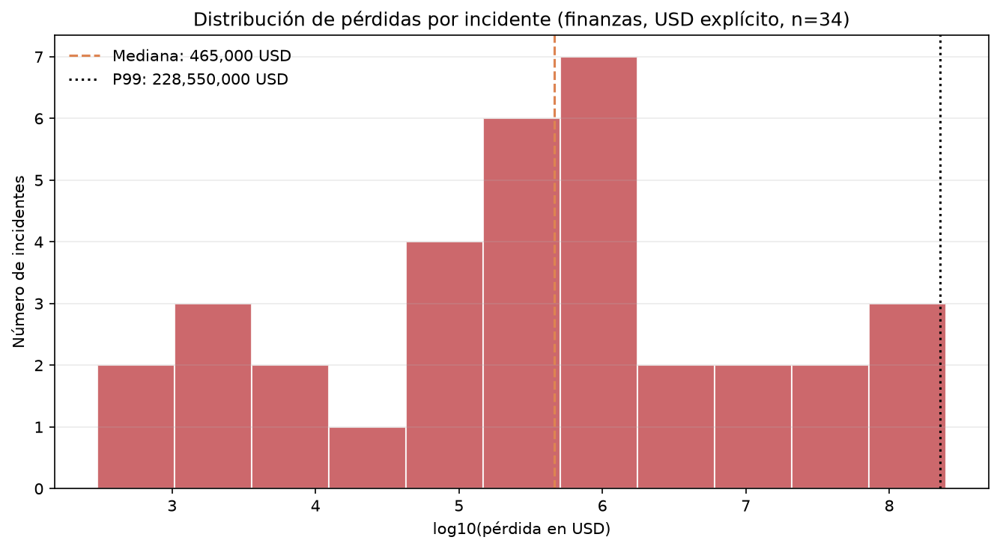

# Cyber-VaR DORA

Cuantificación del **Valor en Riesgo (VaR)** por incidentes de ciberseguridad en entidades financieras, usando un enfoque de **distribución de pérdidas (LDA)**: frecuencia de Poisson + severidad de cola pesada + simulación de Montecarlo.

El objetivo es construir una herramienta reproducible que traduzca el histórico de incidentes en una distribución anual de pérdidas y permita responder preguntas de negocio como:

- ¿Cuánto capital económico debería reservar una entidad para cubrir un año adverso?
- ¿Cómo cambia esa cifra si la frecuencia de ataques se duplica?
- ¿Qué parte del riesgo explican los eventos de baja frecuencia y alta severidad?

> **Contexto regulatorio.** DORA (Reglamento (UE) 2022/2554) exige un marco de gestión del riesgo TIC y capacidades de cuantificación, pero no impone una fórmula de VaR ni un capital regulatorio único. En este proyecto el VaR se interpreta como **capital económico interno**, herramienta de apetito de riesgo y stress testing, no como una cifra regulatoria prescrita.

---

## Estado del proyecto

| Fase | Descripción | Estado |
|---|---|---|
| 0 | Entorno, estructura y control de versiones | ✅ |
| 1 | Ingesta del VCDB | ✅ |
| 2 | Limpieza, filtrado y EDA | 🚧 |
| 3 | Ajuste de frecuencia y severidad | ⏳ |
| 4 | Montecarlo y VaR / Expected Shortfall | ⏳ |
| 5 | Documentación y business case | ⏳ |

Leyenda: ✅ completado · 🚧 en curso · ⏳ pendiente

---

## Fuente de datos

[VCDB (VERIS Community Database)](https://github.com/vz-risk/VCDB): base de incidentes de ciberseguridad de código abierto, codificados con el esquema VERIS.

El pipeline descarga el archivo combinado `data/joined/vcdb.json.zip`, que **excluye unas 5.000 brechas repetitivas de web skimmers** para no sesgar la muestra. El dataset bruto no se versiona en Git: se descarga con un script y se verifica con SHA-256.

### Perfil del dataset (EDA preliminar)

Tras el ETL (`scripts/build_dataset.py`) y el EDA (`scripts/run_eda.py`):

| Métrica | Todos los sectores | Finanzas y seguros (NAICS 52*) |
|---|---|---|
| Incidentes | 10.047 | 893 |
| Con importe extraíble | 325 | 61 (6,8%) |
| En la ventana 2005-2025 | 9.990 | 889 |
| Mediana de pérdida (USD explícito) | 325.000 USD | 450.000 USD |
| P99 (USD explícito) | 836 M USD | 228 M USD |
| Máximo | 1 billón USD (outlier) | 250 M USD |

- Monedas en finanzas: **35 USD explícitos**, 19 sin moneda (asumidos USD, con flag), 2 THB, 2 GBP, 1 INR, 1 EUR y 1 ZAR.
- La cobertura temporal está concentrada entre 2012 y 2018; el pico de 2023 y el valle de 2022 reflejan cambios de cobertura, no de frecuencia real.
- El máximo de 1·10¹² USD corresponde a un registro de Yahoo (2016) y es incompatible con las cifras públicas: se tratará como **error de codificación**, no como observación válida.





**Implicación:** con n=61 no es posible estimar de forma robusta una severidad ni un VaR al 99,9%. El proyecto documentará esta limitación y explorará alternativas (severidad *pooled* entre sectores, benchmarks externos y análisis de sensibilidad). Ver [`docs/decisiones.md`](docs/decisiones.md).

---

## Estructura

```text
.
├── config/
│   └── config.yaml          # Parámetros del pipeline y de la simulación
├── data/
│   ├── raw/                 # Descargas originales (ignoradas por Git)
│   ├── processed/           # Datasets limpios en Parquet (ignorados por Git)
│   └── reference/           # Tipos de cambio, inflación, umbrales
├── docs/
│   ├── decisiones.md        # Registro de decisiones metodológicas
│   ├── diccionario_datos.md # Esquema del dataset procesado
│   └── metodologia.md       # Documento metodológico (en construcción)
├── notebooks/               # EDA, ajuste y simulación (narrativa)
├── outputs/
│   ├── figures/             # Gráficos generados
│   ├── tables/              # Resultados en CSV
│   └── logs/
├── scripts/                 # Puntos de entrada ejecutables
├── src/cybervar/
│   ├── config.py            # Carga tipada de configuración
│   ├── data/                # Descarga y ETL
│   ├── models/              # Frecuencia y severidad
│   ├── simulation/          # Motor de Montecarlo
│   └── reporting/           # Gráficos y tablas
└── tests/                   # Tests con pytest
```

---

## Instalación

Requisitos: Python 3.12+ y Git.

```powershell
# 1. Crear y activar el entorno virtual
python -m venv .venv
.\.venv\Scripts\Activate.ps1

# 2. Instalar el paquete en modo editable (incluye dependencias de desarrollo)
python -m pip install --upgrade pip
python -m pip install -e ".[dev]"
```

---

## Uso

```powershell
# Descargar y verificar el VCDB (≈21 MB de JSON)
python scripts/download_data.py

# Construir los datasets procesados (todos los sectores y solo finanzas)
python scripts/build_dataset.py

# Perfilado rápido y figuras del EDA
python scripts/run_eda.py
```

Los artefactos se generan en:

- `data/processed/incidents_all.parquet`
- `data/processed/incidents_finance.parquet`
- `outputs/tables/eda_summary.csv`
- `outputs/figures/`

---

## Metodología (resumen)

1. **Frecuencia:** estimación de λ anual y contraste de Poisson frente a Binomial Negativa si hay sobredispersión.
2. **Severidad:** ajuste por máxima verosimilitud de Lognormal, Weibull, Gamma y Pareto, con truncamiento por umbral de recolección.
3. **Selección de modelo:** Kolmogorov-Smirnov, Anderson-Darling, Cramér-von Mises, AIC/BIC y bootstrap.
4. **Agregación:** Poisson compuesto simulado de forma vectorizada (≥200.000 escenarios).
5. **Métricas:** VaR a 95%, 99% y 99,9%, más Expected Shortfall (TVaR) y análisis de convergencia.
6. **Sensibilidad:** λ, umbral, distribución de severidad y escenarios de tipo de cambio.

Todas las cifras serán reproducibles mediante semilla y archivo de configuración.

---

## Tests

```powershell
python -m pytest
```

---

## Limitaciones conocidas

- El VCDB **no es un censo**: los conteos anuales reflejan cobertura mediática, no la frecuencia real de una entidad.
- La mayoría de incidentes no declara importe; la muestra de severidad es pequeña y está sesgada hacia casos públicos.
- Las monedas y los años son heterogéneos; requieren normalización explícita.
- El VaR es una medida de pérdida en un horizonte anual y no captura riesgo de cola extrema por sí solo: se complementa con Expected Shortfall.

---

## Licencia

Pendiente de definir.
